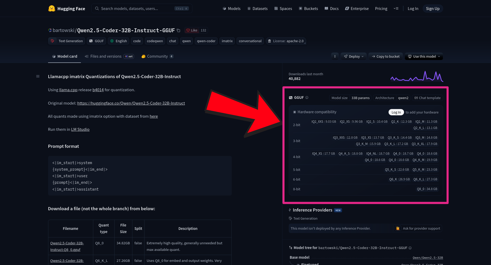

# Portable llama.cpp setup

Run a local language model on Windows or Ubuntu Linux with the bundled
`llama.cpp` programs. The model is downloaded separately and stored in
`models/`.

## Start on Windows

1. Download a `.gguf` model using the [model guide](#choose-a-model).
2. Put the file directly in the `models` folder.
3. Copy its exact filename into `model.txt`.
4. Double-click `start_tui.bat` for terminal chat. To use the browser chat,
   double-click `start_gui.bat`, then visit <http://127.0.0.1:8080>.

## Start on Ubuntu Linux

The included Linux programs are for x64 and require OpenSSL 3. Install the
`libssl3` package (or `libssl3t64` on releases that use that package name).

1. Download a `.gguf` model using the [model guide](#choose-a-model).
2. Put the file directly in `models/` and copy its exact filename into
   `model.txt`.
3. From the repository directory, make the launchers and programs executable:

    ```bash
    chmod +x start_tui.sh start_gui.sh llama-linux/llama-cli llama-linux/llama-server
    ```

4. Start terminal chat with `./start_tui.sh`. For browser chat, run
   `./start_gui.sh` and visit <http://127.0.0.1:8080>.

Both launchers read the model filename from `model.txt`. You can override it by
passing a filename directly, for example `./start_tui.sh my-model.gguf` or
`start_tui.bat my-model.gguf`. The model file must be directly inside `models/`.

## Choose a model

These suggestions use Q4_K_M GGUF files, a common balance of size and quality.
File sizes are approximate. The computer needs additional memory for the
operating system, the model context, and other applications, so choose a model
smaller than the total available RAM or VRAM suggests. Model and quantization
details are listed on each Hugging Face page.

| CPU system RAM / GPU VRAM\* | Coding model                                                                            | Approx. file size |
| --------------------------- | --------------------------------------------------------------------------------------- | ----------------: |
| 4–8 GB RAM / 4 GB VRAM      | [Qwen2.5-Coder 1.5B](https://huggingface.co/bartowski/Qwen2.5-Coder-1.5B-Instruct-GGUF) |            1.1 GB |
| 8–16 GB RAM / 6 GB VRAM     | [Qwen2.5-Coder 3B](https://huggingface.co/bartowski/Qwen2.5-Coder-3B-Instruct-GGUF)     |            1.9 GB |
| 16+ GB RAM / 8 GB VRAM      | [Qwen2.5-Coder 7B](https://huggingface.co/bartowski/Qwen2.5-Coder-7B-Instruct-GGUF)     |            4.7 GB |
| 24+ GB RAM / 12 GB VRAM     | [Qwen2.5-Coder 14B](https://huggingface.co/bartowski/Qwen2.5-Coder-14B-Instruct-GGUF)   |            9.0 GB |
| 32+ GB RAM / 24 GB VRAM     | [Qwen2.5-Coder 32B](https://huggingface.co/bartowski/Qwen2.5-Coder-32B-Instruct-GGUF)   |           19.9 GB |

For general chat
instead of coding, try [Qwen2.5-3B-Instruct](https://huggingface.co/bartowski/Qwen2.5-3B-Instruct-GGUF),
[Qwen2.5-7B-Instruct](https://huggingface.co/bartowski/Qwen2.5-7B-Instruct-GGUF), or
[Qwen2.5-14B-Instruct](https://huggingface.co/bartowski/Qwen2.5-14B-Instruct-GGUF).
You can also browse [other GGUF text models](https://huggingface.co/models?pipeline_tag=text-generation&library=gguf).

On each model page (see screenshot for how to download on Huggingface website), download the file ending in `Q4_K_M.gguf`.



### Using a GPU

The bundled Windows and Linux programs run on CPU. A computer having a GPU
does not make these programs use it. To use GPU acceleration, install a
GPU-enabled llama.cpp build that matches your GPU and use its programs and
required libraries in place of the bundled ones. See the official
[llama.cpp build guide](https://github.com/ggml-org/llama.cpp/blob/master/docs/build.md)
for supported backends and setup. With a GPU-enabled build, choose a model
that fits in available VRAM; partial GPU offload is also possible. With the
bundled programs, choose based on system RAM.

\*VRAM amounts are rough starting points for a GPU-enabled build. Leave room
for the desktop, context, and other GPU applications.

## TUI and GUI

- **TUI:** `start_tui.bat` on Windows or `./start_tui.sh` on Linux opens an
  interactive terminal chat. It reads the general-purpose assistant
  instructions from `system_prompt.txt`. Edit that file to customize the
  assistant's behavior for coding, study, writing, or other tasks.
- **GUI:** `start_gui.bat` or `./start_gui.sh` starts the local web server on
  `127.0.0.1:8080`. Open <http://127.0.0.1:8080> in a browser. The server is
  only reachable from this computer by default. The GUI does not read
  `system_prompt.txt`; configure its system prompt in the web interface.
  You can copy or adapt the instructions from `system_prompt.txt` if you want
  similar general-purpose behavior in the GUI.

## Troubleshooting

- **Model file not found:** check that the filename in `model.txt` exactly
  matches a `.gguf` file directly inside `models/`.
- **Linux reports a missing shared library:** install OpenSSL 3 (`libssl3` or
  `libssl3t64`) and confirm the Linux executables are marked executable.
- **Port 8080 is busy:** close the other program using the port, then restart
  the GUI launcher.
- **Model is split into shards:** download every shard into `models/` and set
  `model.txt` to the first shard's filename, usually the one containing
  `00001-of-`.

## Files in this project

- `start_tui.bat`, `start_tui.sh` — terminal chat launchers.
- `start_gui.bat`, `start_gui.sh` — local browser chat launchers.
- `model.txt` — filename of the selected GGUF model.
- `system_prompt.txt` — system prompt used by the TUI launcher.
- `models/` — place downloaded model files here; model files are not included.
- `llama-windows/`, `llama-linux/` — bundled llama.cpp programs and libraries.

GGUF is the model file format used by llama.cpp. See the Hugging Face
[GGUF documentation](https://huggingface.co/docs/hub/gguf) for more about the
format and finding compatible models.
